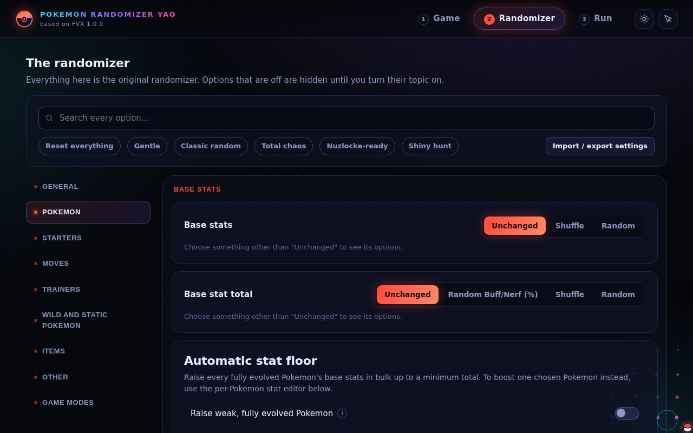
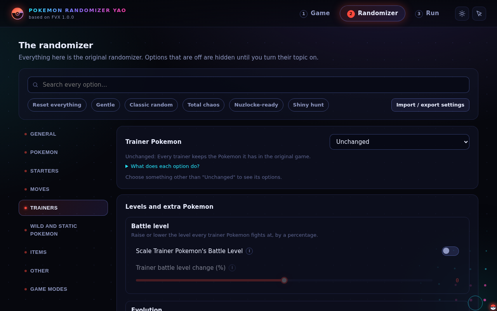
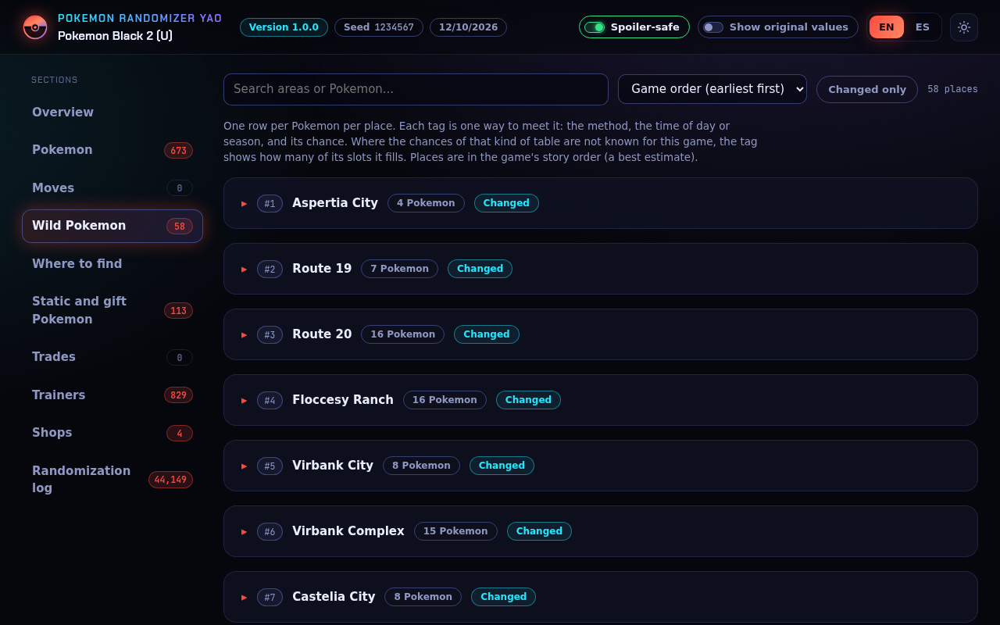

<p align="center">
  
</p>

<h1 align="center">Pokemon Randomizer YAO</h1>

<p align="center"><em>Yet Another One. A Pokemon ROM randomizer for Gen 1 to Gen 7 with a modern web interface, built on Universal Pokemon Randomizer FVX.</em></p>

> **A friendly note.** This is a personal side project and a work in progress. Everything below has been run against the games listed in the tested table, but none of it has been played through from start to finish, so expect rough edges. If you find a bug or have an idea, please [open an issue](https://github.com/ch3ngo/pokemon-randomizer-yao/issues). No report is too small.

## Download and run

You need your own ROM of the game (this project does not include or distribute any). Nothing else to install: the download bundles its own Java.

1. Download the archive for your system from the [Releases page](https://github.com/ch3ngo/pokemon-randomizer-yao/releases) and extract it.
2. Start it:

| Platform | How to start it |
|---|---|
| Windows | Run `web-launcher.bat` |
| Linux (x86 and ARM) | `chmod +x web-launcher.sh`, then `./web-launcher.sh` |
| macOS (Intel and Apple Silicon) | Run `web-launcher.command` (first time: right click, Open, because the app is not notarized) |

3. Your browser opens the interface. Keep the launcher window open, choose your ROM, pick your options and save the randomized game. Your original ROM is never changed.

If something fails to start, the file `console_output.log` next to the launcher explains why: please include it in a bug report.

**3DS games** must be decrypted. The randomizer can save the result as a Luma3DS patch folder (small, needs the same game version installed) or as a single `.cxi` file (1.7 to 3.5 GB).

## Build it yourself

You need a full JDK 25 (with `javac`) and Git. Gradle is included.

```bash
git clone https://github.com/ch3ngo/pokemon-randomizer-yao.git
cd pokemon-randomizer-yao
./gradlew build            # compile everything and run the tests that need no ROMs
./launch-web.sh            # build and open the web interface (launch-web.bat on Windows)
```

The jar is `random/build/libs/PokemonRandomizerYAO.jar`. `./gradlew :random:createReleaseZips` builds the archives for all five platforms (needs internet). More commands, the command line mode and the project layout are in [wiki/Building-from-source.md](wiki/Building-from-source.md).

## What it is

Pokemon Randomizer YAO randomizes the data of the mainline Pokemon games: wild Pokemon, starters, trainers, static and gift encounters, trades, moves, movesets, evolutions, abilities, base stats, types, items, shops, TMs and more. It keeps every option of FVX and adds more control, a browser interface that runs only on your computer, and a spoiler-safe HTML guide of the randomized game in English and Spanish.

Supported: Generation 1 to 7, including the 3DS games up to Ultra Sun and Ultra Moon. No Switch games. English and Spanish ROMs are the focus.

| | |
|---|---|
|  |  |
| Pick your game by dragging it in or with the file dialog. | Every option, grouped by topic, with an "i" button that explains it. |
|  |  |
| Trainer options, battle style chances and the mega finale. | The guide: searchable, spoiler-safe, English and Spanish names. |

## Added by this project

Everything FVX does is included (randomization of all of the above, HM usability tweaks, custom player graphics for Gen 1 to 3, a command line mode, bundled Java). On top of it:

| Feature | What it does |
|---|---|
| Real shiny chance | 0.1 to 100 percent for wild, static, gift, egg and trainer Pokemon, set inside the game's own shiny check (needs a code patch, so you confirm it first). Not available on FireRed. |
| Egg box | Up to 90 randomized eggs from an in-game character, filtered by legendary, evolution line length and more. Emerald only for now. |
| Shops | Add your own items with a price to every regular Poke Mart. Shuffle or randomize the special shops (balls and mail, department store floors, herbs, vitamins and so on). The regular Poke Marts are never randomized, and you can protect chosen items everywhere. |
| Stat tools | Automatic stat boost for weak, fully evolved Pokemon (raise them to a minimum total, or boost them by a percentage, with a live preview), and a per-Pokemon stat editor (scale or set exact base stats). |
| Stone evolutions by level | One switch: Pokemon with a single stone evolution can also evolve by leveling. Pokemon with several evolutions (Eevee and similar) are left alone. Gen 3 to 7. |
| Real locations in the guide | Static, gift and trade Pokemon show where they are in the HTML guide and log (partial coverage for Black 2, Gen 6 and Gen 7). |
| Custom evolutions | Change, add or remove evolutions and lower evolution levels; invalid edits are refused. Gen 1 and 2: level only. |
| Fully evolved by a level | Pull level-up evolutions earlier so everything is fully evolved by a level you choose. |
| Mega finale | The last Pokemon of chosen trainers holds a mega stone. Only for games with Mega Evolutions. |
| Battle style chances | A chosen share of a trainer group fights as double, triple or rotation battles, where the game allows it. |
| Trainer battle items | The Potions and Full Restores trainers use are limited by tier and stage of the game (ordinary trainers none, gym leaders only the potion that fits, Full Restore only for the Elite Four and bosses at high levels). Gen 3 to 7. |
| Incremental movesets | "Better movesets" follows a power curve by level and trainer tier: moves come from what the Pokemon can learn and favour a power that fits the stage: around 50 to 60 at the first gyms, Elite Four trainers mostly 65 to 95 power moves with a rare 120 or 150. Physical and special attackers get fitting moves, status moves are allowed everywhere but rare, and a set always has at least two attacking moves. Trainers only, never wild, static, gift or trade Pokemon. If the Pokemon movesets are randomized too, trainers get their own, separately randomized learnsets, different from the ones your Pokemon get. |
| Locke and Soft-locke (**experimental**) | Revive items removed and Pokemon Centers that stop reviving. Pokemon Center part on HeartGold, SoulSilver, Black 2 and White 2 only. |
| Softlock check | Warns if no Pokemon you can get can learn a field move the game needs early on. |
| Modified ROM warning | Tells you if a ROM is not an unmodified retail dump (Gen 1 to 5). |
| HTML guide and log | A spoiler-safe, searchable page of everything randomized, plus a matching text log. |
| Web interface | Runs in your browser, only on your own computer. |

Limits worth knowing: a ROM editor cannot write to your save, so eggs come from an in-game character; Gen 2 trainer Pokemon use fixed values per trainer class, so a shiny chance is not exact for them. Details of each feature are in the [wiki folder](wiki/Home.md).

## Tested so far

"Tested" means the randomizer ran against that ROM with a broad set of options, the output was written and read back, and the guide and log were checked against the randomized data. It does not mean the game was played through in an emulator or on a console (Omega Ruby's output has never been booted).

- **Tested:** Crystal (English), Emerald (English), FireRed, Diamond, Platinum, SoulSilver, Black, Black 2 (all English and Spanish), X, Omega Ruby, Sun, Ultra Sun (English).
- **Not tested, no ROM available yet:** Red, Blue, Yellow, Gold, Silver, Ruby, Sapphire, LeafGreen, Pearl, HeartGold, White, White 2, Y, Alpha Sapphire, Moon, Ultra Moon. They are implemented at the code level. If you try one, please report what you find.
- The Black and Black 2 ROMs used are "Fix" dumps, so the integrity check will warn.
- Japanese, French, German and Italian ROMs are not a current focus.

## Still in development

Egg boxes for other generations, player sprite replacement for every generation with a sprite library, finishing Locke mode, a move editor, free replacement of HM moves, level caps, an option to avoid legendaries in static, gift and trade Pokemon, safe extra trainer Pokemon in back-to-back fights, and native installers.

## Documentation

The `wiki/` folder documents this project's own additions ([start here](wiki/Home.md)). For the original FVX options, the "i" buttons in the interface link to the [FVX wiki](https://upr-fvx.github.io/universal-pokemon-randomizer-fvx/), which is still the reference for them. This project has no published wiki of its own yet.

## Credits

All credit for the randomizer itself belongs to the authors of the projects this descends from:

- **[Dabomstew](https://github.com/Dabomstew/universal-pokemon-randomizer)**: the original Universal Pokemon Randomizer.
- **Ajarmar** and the **UPR-ZX** team: [Universal Pokemon Randomizer ZX](https://github.com/Ajarmar/universal-pokemon-randomizer-zx).
- **FVX** ([foxoftheasterisk](https://github.com/foxoftheasterisk), [voliol](https://github.com/voliol)) and the [upr-fvx](https://github.com/upr-fvx/universal-pokemon-randomizer-fvx) contributors: Universal Pokemon Randomizer FVX.
- **yao** (ch3ngo): the additions listed above.

Changes are marked in the code and the commit history, starting 10/10/2026. The original FVX readme is kept as `UPSTREAM_README.md`. Pokemon and all related names, sprites and game data belong to Nintendo, Game Freak and Creatures; this project is not affiliated with them.

## License

GPL-3.0-or-later, inherited from upstream. See `LICENSE.txt`. The source file headers of the original authors are kept intact.

## Feedback, bugs and ideas

Please use the [Issues page](https://github.com/ch3ngo/pokemon-randomizer-yao/issues) for bugs, confusing text, ideas, or games you tested that are not listed above. For a bug, it helps to include the game and its language, the settings (the web interface can export a `.rnqs` file), and the log. This is a spare-time project, so replies may take a while, but everything gets read.
